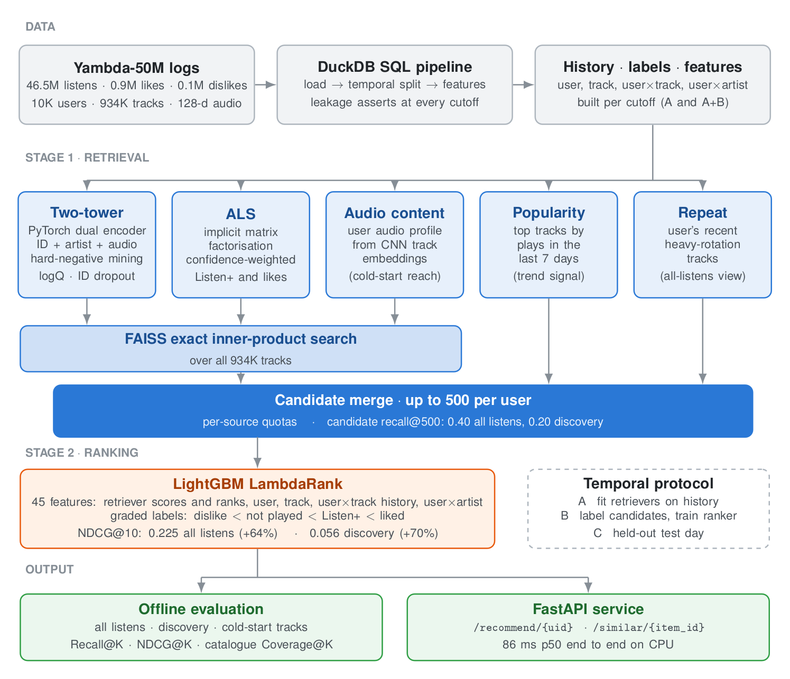
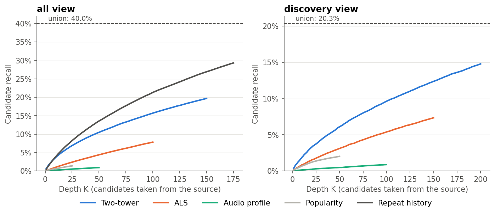
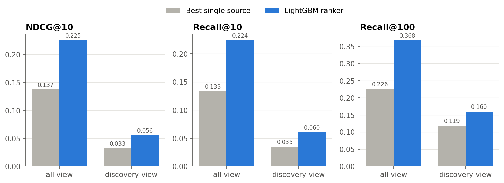

# audio-aware-music-recommender

**A two-stage music recommender built on 47M real listening events from Yandex Music.** A PyTorch two-tower model with an audio-aware track encoder, ALS collaborative filtering and audio content-based retrieval generate candidates through FAISS. A LightGBM LambdaRank model then re-ranks them using 45 engineered features. The pipeline is evaluated with a leakage-safe temporal split, both on all listens and on discovery of tracks a user has never heard.

| Result (test day, Listen+) | Value |
|---|---|
| NDCG@10, all listens | **0.225**, versus 0.078 for the best model published with the dataset (ItemKNN) |
| NDCG@10, discovery (tracks the user never played) | **0.056**, **+70%** over the best single retriever |
| Recall@100, discovery | **0.160**, **+35%** over the best single retriever |
| Recall@100 on cold-start tracks (zero plays before the test day) | **0.084** from audio and artist signals; ID-based collaborative filtering cannot retrieve these at all |
| Serving latency, full two-stage request on CPU | **86 ms p50**, 93 ms p95 |

Full write-up: [report.md](report.md). Notebooks with every chart: [notebooks/](notebooks/).

---

## Highlights

- **Real interaction data at scale.** Yambda-50M has 46.5M listens plus about 1M likes and dislikes, from 10,000 users over 934,057 tracks and 300 days. The data pipeline in DuckDB SQL and pandas turns raw logs into implicit-feedback training data, history tables, labels and features. It builds in 20 seconds on a laptop.
- **Leakage-safe temporal evaluation.** The split follows the dataset's official global temporal protocol. The retrievers learn from period A, the ranker trains on candidates labelled with period B, and the test is period C. Asserts in the build fail if any history row reaches its cutoff.
- **Two evaluation views.** 69% of test-day listens are re-listens, so "all listens" rewards replaying known tracks. A separate **discovery** view scores only tracks the user has never played and removes their history from every ranking.
- **Five retrieval sources, merged into up to 500 candidates per user:**
  - a PyTorch **two-tower model**, described in the next item;
  - **ALS** matrix factorisation (`implicit`), searched with FAISS;
  - **content-based audio retrieval** over 128-d audio embeddings, also searched with FAISS;
  - a 7-day **popularity** list;
  - a **repeat** source of the user's recent heavy-rotation tracks.
- **Audio-aware two-tower model (64.6M parameters).** The track tower combines an ID embedding, a 32-d artist embedding and an MLP over the audio embedding. With ID dropout during training, the tower learns to place tracks from audio and artist alone, so brand-new tracks still get useful vectors. The user tower pools the last 100 tracks with attention and a learned recency bias. Training uses sampled softmax with in-batch negatives, logQ popularity correction, hard negatives re-mined every 1,000 steps and fp16 mixed precision.
- **Learning-to-rank stage.** A LightGBM `lambdarank` model, one per view, uses graded labels: disliked < not played < Listen+ < liked. Dislikes act as explicit negatives. Its 45 features cover users, tracks, user×track history, user×artist affinity, and every retriever's score and rank. Stage 2 lifts NDCG@10 by **64%** (all listens) and **70%** (discovery) over the best single retriever.
- **Each stage measured on its own.** Stage 1 reports candidate recall@500, the ceiling for the ranker. Stage 2 reports NDCG, Recall and Coverage @ {10, 50, 100}. Catalogue coverage is tracked throughout, alongside accuracy.
- **Ablations** on hard negatives, audio features and a cold-start track slice.
- **Serving prototype.** A FastAPI service exposes `/recommend/{uid}` (both stages, both views) and `/similar/{item_id}` (audio "sounds like" neighbours), with per-stage latency benchmarks. Its candidates and features match the batch pipeline row for row.
- **Multi-machine compute.** GPU training ran on a Slurm cluster with RTX 2080 Ti GPUs, at 179–193K examples/s and about 7.5 minutes per model. CPU stages ran on 38-core nodes, alongside a local RTX 3070 Ti. Everything runs through `make` targets with pinned dependencies.

## Architecture



Full-size image: [`docs/architecture.png`](docs/architecture.png).

## Results

All numbers are on the held-out test day: 4,600 users with at least one Listen+ in the all-listens view, 3,309 in the discovery view.

### Stage 1: retrieval sources

| Source | All: Recall@100 | All: NDCG@10 | Discovery: Recall@100 | Discovery: NDCG@10 | Coverage@100 |
|---|---|---|---|---|---|
| Two-tower (audio-aware) | 0.226 | 0.137 | 0.119 | 0.033 | 0.103 |
| Repeat (own history) | 0.303 | 0.131 | n/a | n/a | 0.112 |
| ALS | 0.093 | 0.031 | 0.068 | 0.014 | 0.028 |
| Popularity (7 days) | 0.057 | 0.022 | 0.057 | 0.013 | 0.000 |
| Audio content-based | 0.022 | 0.008 | 0.011 | 0.002 | **0.144** |
| **Merged candidates (recall@500)** | **0.400** | | **0.203** | | |



The two-tower model retrieves **2.4×** as many test-day listens as ALS, and **1.7×** as many on discovery. Pure audio similarity is weak at predicting what a user plays next. It has the widest catalogue coverage, though, and it is the signal that makes cold-start tracks reachable.

### Stage 2: LightGBM re-ranking

| View | Best single retriever NDCG@10 | LightGBM NDCG@10 | LightGBM Recall@10 | LightGBM Recall@100 | Coverage@100 |
|---|---|---|---|---|---|
| All listens | 0.137 | **0.225** (+64%) | 0.224 | 0.368 | 0.100 |
| Discovery | 0.033 | **0.056** (+70%) | 0.061 | 0.160 | 0.071 |



The strongest features in the all-listens view are days since the user last played the track, average played ratio, and the two-tower rank and score. In the discovery view they are the track's 7-day trend, ALS score, two-tower score and rank, and user–artist affinity.

### Reference: models published with the dataset

The table below shows Yambda-50M Listen+ numbers from the dataset paper ([Ploshkin et al., 2025](https://arxiv.org/abs/2505.22238), Table 6), next to this project's "all listens" view, which uses the same split and target. The published numbers came from an earlier version of the dataset authors' metric code, which aggregated NDCG and normalised Recall in a different way, so they serve as a reference point with known differences. As a calibration check, the untuned ALS here (NDCG@10 0.031) lands close to the paper's tuned iALS (0.041).

| Model | NDCG@10 | Recall@100 |
|---|---|---|
| ItemKNN (best published) | 0.078 | 0.130 |
| SASRec (published) | 0.075 | 0.103 |
| iALS (published) | 0.041 | 0.081 |
| Two-tower, this project | 0.137 | 0.226 |
| **Two-stage pipeline, this project** | **0.225** | **0.368** |

### Ablations (two-tower retrieval, test day)

| Variant | All: Recall@100 | Discovery: Recall@100 | Cold: Recall@100 | Cold: NDCG@10 |
|---|---|---|---|---|
| Main: ID + artist + audio, hard negatives | 0.226 | 0.119 | 0.084 | **0.034** |
| No audio branch | 0.221 | 0.113 | 0.082 | 0.024 |
| No mined hard negatives | 0.223 | 0.121 | 0.084 | 0.029 |

- **Audio** improves discovery recall by 5% and cold-start ranking quality (NDCG@10) by 39%.
- **Hard negatives** gave no consistent gain at this training budget (82M examples). They helped cold-start NDCG@10 and stayed within noise elsewhere.
- The cold slice is 1,329 test-day listens of tracks with zero plays before the cutoff. ID-based collaborative filtering scores zero on it by construction.

Each variant is a single run.

## Repository layout

```
sql/                 01_load.sql · 02_split.sql · 03_features.sql   (DuckDB pipeline)
src/yrec/
  data.py            runs the SQL; time windows and cutoffs; audio embedding extraction
  metrics.py         Recall / NDCG / Coverage @K, candidate recall, two evaluation views
  sources.py         popularity, repeat, ALS, audio-profile retrieval sources
  twotower.py        PyTorch two-tower model (single GPU or DDP via torchrun)
  retrieval.py       stage 1: FAISS search, candidate merge, stage-1 metrics, two-tower ablation eval
  ranker.py          stage 2: feature join (DuckDB), LightGBM LambdaRank, stage-2 metrics
  serve.py           FastAPI prototype + latency benchmark
notebooks/           01_eda · 02_retrieval_sources · 03_two_tower · 04_retrieve_and_rank · 05_ablations
results/             every metric reported above, as JSON
docs/                architecture diagram (TikZ source, SVG, PNG)
Makefile             pipeline targets (`make help`)
job.sbatch           Slurm wrapper that runs one make target on a cluster node
```

## Reproducing

Requirements: Python 3.12, about 20 GB of free disk (the raw audio-embedding file is 13.8 GB and is reduced to 240 MB), and a CUDA GPU for the two-tower model. An 8 GB laptop GPU is enough.

```bash
pip install -r requirements.txt   # pinned versions; `make setup` also installs CUDA torch
make download                     # raw Yambda-50M files from Hugging Face -> data/raw
make data audio                   # SQL pipeline -> data/proc, audio embeddings -> audio.npy
make tt_A tt_AB                   # two-tower models for the ranker-training and test cutoffs
make tt_AB_nohn tt_AB_noaudio     # ablation models
make retrieval rank ablations     # stage 1, stage 2, two-tower ablation metrics -> results/
PYTHONPATH=src python -m yrec.serve --bench 200   # serving latency -> results/serving_latency.json
PYTHONPATH=src python -m yrec.serve               # API on 127.0.0.1:8000
```

On a Slurm cluster: `sbatch -J data --export=ALL,TARGET=data job.sbatch`. GPU targets add `--gres=gpu:1`.

### Command-line arguments

| Module | Arguments |
|---|---|
| `yrec.data` | `build` · `audio <embeddings.parquet>` · `items` |
| `yrec.twotower` | `--cutoff {A,AB}` `--out DIR` `--steps 20000` `--batch 4096` (per GPU) `--lr 1e-3` `--tau 0.05` `--hist-len 100` `--id-dropout 0.3` `--no-audio` `--no-hard-neg` `--hn-every 1000` `--hn-num 8` `--hn-pool 64` `--eval` (Recall@100 on the next window, cutoff A only) `--seed 0` |
| `yrec.retrieval` | `--cut {A,AB}` (candidates + stage-1 metrics) · `--tt DIR` (two-tower vectors, default `artifacts/tt_<cut>`) · `--eval-tt DIR` (two-tower-only metrics incl. cold slice) |
| `yrec.ranker` | `--view {all,discovery,both}` `--results results` `--artifacts artifacts` |
| `yrec.serve` | `--artifacts artifacts` `--tt-dir artifacts/tt_AB` `--bench N` (latency benchmark) `--out FILE` |

Multi-GPU training: `PYTHONPATH=src torchrun --nproc_per_node=4 -m yrec.twotower --cutoff AB --out artifacts/tt_AB`.

### API

```bash
curl "127.0.0.1:8000/recommend/<uid>?view=discovery&k=20"   # ranked tracks, proposing sources, per-stage timings
curl "127.0.0.1:8000/similar/<item_id>?k=20"                 # audio nearest neighbours
```

## Tech stack and techniques

Python · PyTorch (DDP, AMP) · LightGBM · FAISS · DuckDB / SQL · pandas · NumPy · SciPy · scikit-learn · implicit · FastAPI · Slurm · Jupyter · Matplotlib

Recommender systems · personalisation · two-stage retrieval and ranking · candidate generation · learning-to-rank (LambdaRank) · two-tower / dual-encoder models · embeddings and approximate nearest-neighbour search · collaborative filtering (matrix factorisation, ALS) · content-based filtering · audio embeddings · cold-start · hard-negative mining · sampled softmax with logQ correction · implicit and explicit feedback · feature engineering · temporal train/test splits and leakage prevention · offline evaluation (Recall@K, NDCG@K, catalogue coverage) · ablation studies · model serving and latency benchmarking · data pipelines on real user interaction data

## Data and license

The project uses [Yambda-50M](https://huggingface.co/datasets/yandex/yambda) (Apache 2.0), published by Yandex for research. No data is redistributed in this repository.
